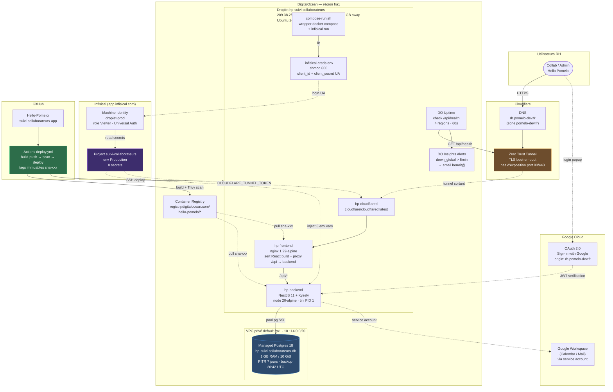

# Architecture — Suivi Collaborateurs Hello Pomelo

Dernière MAJ : 2026-11-27 (migration Supabase → DigitalOcean, chantier post-audit)

## Vue d'ensemble



## Flows détaillés

### 1. Requête utilisateur (HTTPS)

```
User → Cloudflare DNS (rh.pomelo-dev.fr)
     → Cloudflare Zero Trust Tunnel
     → hp-cloudflared (tunnel sortant, aucun port ouvert)
     → hp-frontend (nginx) : sert /dist/* statique
                             proxy_pass /api/* → hp-backend:4000
     → hp-backend (NestJS) : JWT verify → Kysely → pool pg
     → Managed Postgres (VPC privé, SSL requis, user hp_app)
```

TLS : Cloudflare → tunnel sortant chiffré, pas de certif à gérer côté droplet.

### 2. Déploiement (GitHub Actions)

```
git push master (après merge PR)
  → deploy.yml se déclenche
  → build-push  : docker buildx → tags :latest + :sha-<short>
                  push vers registry.digitalocean.com/hello-pomelo/*
  → scan        : Trivy sur les 2 images, CRITICAL → fail
  → deploy      : SSH root@droplet
                  sed IMAGE_TAG=sha-<short> dans /opt/suivi-collaborateurs/.env
                  ./compose-run.sh pull backend frontend
                  ./compose-run.sh up -d --no-deps backend frontend
  → smoke test  : docker run --network hp_edge curl http://frontend/api/health
                  retry 60s max
```

Rollback : le tag immuable précédent est toujours dans le registry → redéploy manuel possible en changeant `IMAGE_TAG` dans `.env` + `./compose-run.sh up -d`.

### 3. Injection des secrets (Infisical)

```
./compose-run.sh <args>
  → source /opt/suivi-collaborateurs/.infisical-creds.env
      → charge INFISICAL_CLIENT_ID + INFISICAL_CLIENT_SECRET (Universal Auth)
  → infisical login --method=universal-auth
      → POST app.infisical.com/api/v1/auth/universal-auth/login
      → récupère access token (TTL 30 jours, max use illimité)
  → infisical run --token=<TOK> --projectId=<P> --env=prod --path=/
      → pull 8 secrets : DATABASE_URL, JWT_SECRET, GOOGLE_*, CLOUDFLARE_TUNNEL_TOKEN
      → inject en env vars du process docker compose
  → docker compose up -d
      → compose expand ${VAR} depuis l'env du process parent
      → containers démarrent avec les secrets en RAM
```

Le droplet n'a plus **aucun secret applicatif en clair sur disque**, seulement les credentials Universal Auth (bootstrap-only).

### 4. Observabilité

- **DO Uptime** : 4 régions (Asia East, USA East, USA West, Europe) pingent `https://rh.pomelo-dev.fr/api/health` toutes les 60s
- **Alerte** : `do.uptime.down_global >= 1` pendant 5 min → email `benoit@hello-pomelo.com`, re-notif toutes les 4h tant que non résolu
- **Logs** : `docker logs hp-{backend,frontend,cloudflared}` sur le droplet (pas de centralisation pour l'instant — chantier futur avec Alloy + Grafana central si Palett en a un)

## Inventaire des secrets

Tous les secrets prod sont dans **Infisical** (projet `suivi-collaborateurs`, env `Production`) :

| Secret | Usage | Source |
|---|---|---|
| `DATABASE_URL` | Connection string Postgres (user `hp_app`) | Managed DB DO |
| `JWT_SECRET` | Signature des JWT backend (TTL 7j) | généré, 64 chars |
| `GOOGLE_CLIENT_ID` | OAuth Sign-In with Google | Google Cloud Console |
| `GOOGLE_MAIL_ENABLED` | Feature flag mail | false actuellement |
| `GOOGLE_CALENDAR_ENABLED` | Feature flag calendar | false actuellement |
| `GOOGLE_IMPERSONATE_DEFAULT` | Impersonation Workspace | vide (désactivé) |
| `GOOGLE_MAIL_FROM` | From address pour envois | vide |
| `CLOUDFLARE_TUNNEL_TOKEN` | Token tunnel Zero Trust | Cloudflare dashboard |

Bootstrap (le seul truc en clair sur le droplet, chmod 600) : `/opt/suivi-collaborateurs/.infisical-creds.env`
- `INFISICAL_PROJECT_ID`
- `INFISICAL_CLIENT_ID`
- `INFISICAL_CLIENT_SECRET` (identity Viewer, lecture seule)
- `INFISICAL_ENV=prod`

## Base de données

Référence complète : `backend/db/init/01_schema.sql` + miroir types Kysely dans `backend/src/config/database.types.ts`.

12 tables, 18 index, PITR 7 jours. Ownership `hp_app` sur toutes les tables + schéma `public` (le `doadmin` DO ne sert que pour les migrations initiales ou le restore).

## Points durs connus

1. **OOM potentiel** : 961 MB RAM + 2 GB swap. Ne JAMAIS builder Docker sur le droplet (tsc tue le sshd). Tout build passe par GitHub Actions runners (7 GB).
2. **Pas de redondance DB** : Managed DB "Basic 1 vCPU" = single node. Un restore prend ~15-30 min sur un fork, > 1h sur bascule complète (RTO scénario B dans runbook).
3. **Cloudflare DNS** : zone gérée par Augustin (Palett). Besoin DNS Admin pour créer d'autres sous-domaines (statut : demande en cours).
4. **Secrets bootstrap** : si `.infisical-creds.env` est compromis, l'attaquant peut lire les 8 secrets prod. Mitigation : chmod 600 + rotation périodique de la machine identity (TODO : cron mensuel).
